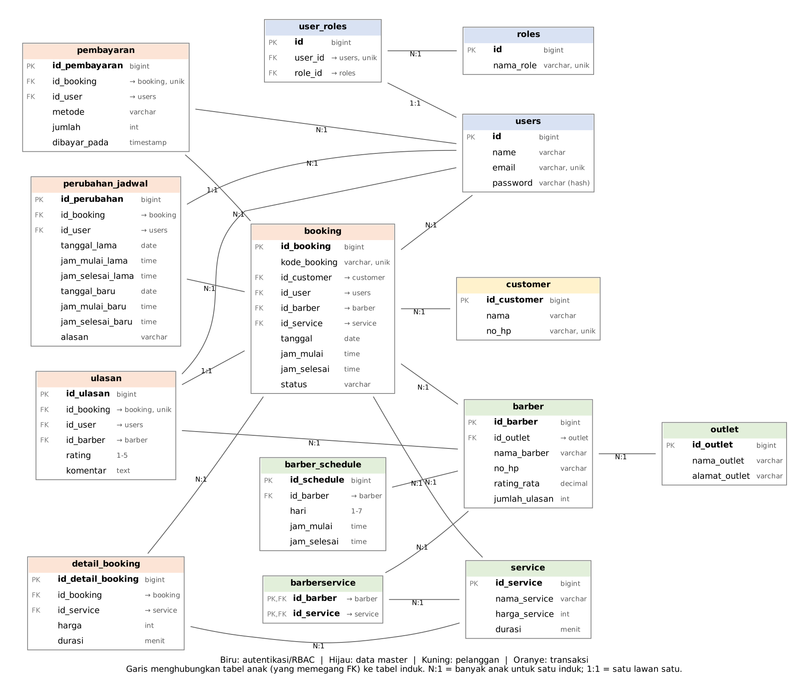
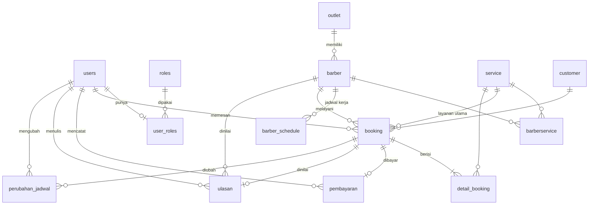

# Cukur.in

Aplikasi web pemesanan barbershop berbasis **Laravel 13** dan **PostgreSQL**. Pelanggan memesan satu atau beberapa layanan
pada barber dan jam yang tersedia, lalu membayar, mengubah jadwal, dan memberi ulasan. Admin mengelola cabang, layanan,
barber beserta jadwal kerjanya, memproses booking dan pembayaran, serta melihat laporan pendapatan.

Proyek UAS mata kuliah Pengembangan Perangkat Lunak Web (Framework), kelompok 3 anggota.

## Anggota dan pembagian peran

| Nama                     | NIM       | Peran             | Master                           | Transaksi                          | Bagian yang dikerjakan                                                         |
| ------------------------ | --------- | ----------------- | -------------------------------- | ---------------------------------- | ------------------------------------------------------------------------------ |
| ⁠Braja Re Hendramulya    | 434251111 | Anggota 1 (ketua) | M1 Layanan                       | T1 Booking, T2 Persetujuan Booking | Repository dan branch, autentikasi, RBAC (tabel role, middleware), seeder akun |
| Alvin Gerry Indrajaya    | 434251109 | Anggota 2         | M2 Cabang (Outlet)               | T3 Pembayaran, T4 Ulasan           | Layout Blade, halaman Guest, dashboard tiap role                               |
| Apta Manggala Ezra Salim | 434251110 | Anggota 3         | M3 Barber (beserta Jadwal Kerja) | T5 Ubah Jadwal Booking             | Pengujian otomatis, laporan Query Builder, README dan ERD, Docker (opsional)   |

## Peran pengguna (RBAC)

Peran disimpan di tabel `roles` dan relasi `user_roles`. Akses dibatasi di sisi server dengan middleware `role:` pada route.
Halaman yang tidak diizinkan menghasilkan respons 403, atau pengalihan ke halaman login untuk Guest.

| Peran               | Keterangan                                                                                                      |
| ------------------- | --------------------------------------------------------------------------------------------------------------- |
| Guest               | Pengunjung belum login: melihat landing (layanan, barber, cabang), login, dan registrasi                        |
| Role 1: `admin`     | Pengelola: mengelola master, memproses booking dan pembayaran, melihat ulasan, riwayat ubah jadwal, dan laporan |
| Role 2: `pelanggan` | Memesan, mengubah jadwal, dan membatalkan booking miliknya, serta menulis ulasan                                |

## Data master dan transaksi

| Kode    | Nama                                                 | Pemegang | Keterangan                                                                              |
| ------- | ---------------------------------------------------- | -------- | --------------------------------------------------------------------------------------- |
| M1      | Layanan (`service`)                                  | Braja    | Nama, harga, durasi (menit)                                                             |
| M2      | Cabang (`outlet`)                                    | Gerry    | Nama dan alamat cabang                                                                  |
| M3      | Barber (`barber`) + Jadwal Kerja (`barber_schedule`) | Apta     | Barber per cabang, layanan yang dikuasai (`barberservice`), jam kerja per hari          |
| T1      | Booking (`booking` + `detail_booking`)               | Braja    | Pelanggan memesan banyak layanan sekaligus (header-detail, memakai `DB::transaction()`) |
| T2      | Persetujuan Booking                                  | Braja    | Alur status oleh dua role, admin memutuskan                                             |
| T3      | Pembayaran (`pembayaran`)                            | Gerry    | Admin mencatat pembayaran, status booking ikut berubah                                  |
| T4      | Ulasan (`ulasan`)                                    | Gerry    | Pelanggan menilai barber, rata-rata rating barber ikut diperbarui                       |
| T5      | Ubah Jadwal Booking (`perubahan_jadwal`)             | Apta     | Pelanggan memindahkan jadwal beserta alasan, tercatat dengan pelaku dan waktunya        |
| Laporan | Rekap pendapatan (`/admin/laporan`)                  | Apta     | Query Builder: join, `groupBy`, dan agregat                                             |

Relasi antar master: cabang punya banyak barber (`hasMany`), barber dan layanan saling berhubungan banyak-ke-banyak
(`belongsToMany` lewat `barberservice`). Master yang sudah dipakai transaksi tidak bisa dihapus dan menampilkan pesan yang jelas.

## Matriks hak akses

C = create, R = read, U = update, D = delete, - = tidak ada akses.

| Fitur                      | Guest       | Pelanggan (Role 2)                        | Admin (Role 1)                  |
| -------------------------- | ----------- | ----------------------------------------- | ------------------------------- |
| M1 Layanan                 | R (landing) | R (form booking)                          | C R U D                         |
| M2 Cabang                  | R (landing) | R (form booking)                          | C R U D                         |
| M3 Barber dan Jadwal Kerja | R (landing) | R (form booking dan pilihan jam)          | C R U D                         |
| T1 Booking                 | -           | C R (miliknya), U status batal (miliknya) | R U (status) D                  |
| T2 Persetujuan Booking     | -           | R (miliknya)                              | U _(sesuaikan dengan T2 Braja)_ |
| T3 Pembayaran              | -           | -                                         | C R                             |
| T4 Ulasan                  | -           | C R (miliknya)                            | R                               |
| T5 Ubah Jadwal             | -           | C R (miliknya)                            | R                               |
| Laporan rekap              | -           | -                                         | R                               |
| Dashboard                  | -           | R                                         | R                               |

## ERD





## Teknologi

Laravel 13, PHP 8.3 atau lebih baru, PostgreSQL, Bootstrap 5 dan Vite, Laravel UI untuk autentikasi.

## Instalasi dan menjalankan

Prasyarat: PHP 8.3+ (ekstensi `pdo_pgsql` aktif), Composer, Node.js dan npm, serta PostgreSQL.

1. Buat database kosong di PostgreSQL, misalnya `cukurin`.
2. Pasang dependensi dan siapkan konfigurasi:
    ```
    composer install
    copy .env.example .env      (Linux/macOS: cp .env.example .env)
    php artisan key:generate
    ```
3. Atur koneksi database di `.env`:
    ```
    DB_CONNECTION=pgsql
    DB_HOST=127.0.0.1
    DB_PORT=5432
    DB_DATABASE=cukurin
    DB_USERNAME=postgres
    DB_PASSWORD=isi_password_anda
    ```
4. Buat tabel dan isi data awal dari seeder:
    ```
    php artisan migrate:fresh --seed
    ```
5. Pasang aset tampilan lalu jalankan aplikasi:
    ```
    npm install
    npm run build
    php artisan serve
    ```
6. Buka `http://127.0.0.1:8000`.

Menjalankan tes otomatis (memakai SQLite di memori, tidak menyentuh database Anda):

```
php artisan test
```

## Akun seeder

| Peran     | Email                    | Kata sandi     |
| --------- | ------------------------ | -------------- |
| Admin     | `admin@cukurin.test`     | `admin123`     |
| Pelanggan | `pelanggan@cukurin.test` | `pelanggan123` |

Seeder juga mengisi data cabang, layanan, barber, dan jadwal kerja. Data booking dan pembayaran dibuat lewat aplikasi:
masuk sebagai pelanggan untuk memesan, lalu sebagai admin untuk mencatat pembayaran, setelah itu halaman Laporan akan terisi.
